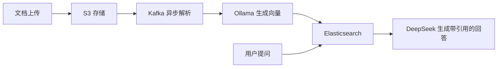

# RAG智能知识助手

基于 Java 和 Vue 的文档知识库问答应用。通过文档解析、关键词与向量检索，为模型回答提供相关资料和来源引用。

## 功能与技术

- 文档管理、分片上传、异步解析与组织权限控制。
- 知识检索、WebSocket 对话、历史记录与滚动摘要。
- 后端：Java 17、Spring Boot、MySQL、Redis、Elasticsearch、Kafka、RustFS（S3 兼容存储）。
- 前端：Vue 3、TypeScript、Vite、Naive UI。

## 名称与图标

应用统一显示“RAG智能知识助手”。Logo 使用文档与放大镜图形，登录页、侧边栏、聊天头像和网站图标保持一致。新日志使用 `rag-assistant` 文件名前缀。

内部数据库名、接口路径、Java 包名和浏览器存储键保留兼容，避免更名导致已有数据或登录状态丢失。

## 开源来源

本项目基于 PaiSmart 修改，保留原作者与许可证信息。原项目说明存档于 [上游说明](docs/UPSTREAM_README.md)，许可见 [LICENSE](LICENSE)。

## 从源码启动

需要 JDK 17、Maven、Node.js 22、pnpm 10、Docker Compose 和 Ollama。在项目根目录复制 .env.example 到本机 .env.local，填写凭据。JWT_SECRET_KEY 使用至少 32 字节随机数据的 Base64 编码。将相同变量设置到启动后端的 Shell 环境中，Spring 不会自动读取该文件。

```powershell
ollama pull qwen3-embedding:0.6b
docker compose --env-file .env.local -f docs/docker-compose.yaml up -d
mvn spring-boot:run "-Dspring-boot.run.arguments=--server.address=127.0.0.1"
```

在本机 RustFS 控制台（http://127.0.0.1:19001/rustfs/console/index.html）用 MINIO_ACCESS_KEY 和 MINIO_SECRET_KEY 登录并创建 uploads 存储桶。打开另一个终端，在 frontend 目录执行：

```powershell
pnpm install --frozen-lockfile --ignore-scripts
pnpm dev
```

使用 ADMIN_PASSWORD 登录。DeepSeek 使用 DEEPSEEK_API_KEY，文档向量化默认使用本机 Ollama，不需要 Embedding 密钥。OCR 默认关闭。此为本机部署示例，Docker 端口仅绑定到回环地址。
## 用示例文档体验

1. 登录后进入知识库，上传 [星港数据保留规则](examples/demo-policy.txt)。
2. 等待异步解析与索引完成，在聊天助手提问：星港演示环境的数据保留期限是多少天？请注明来源。
3. 预期得到 47 天，并能通过引用定位示例文件。



旧版 2048 维索引保持原样。此版本使用独立的 1024 维索引，旧文档需在新环境重新入库。
本机验收已通过一次完整流程，包括上传与合并、异步入库、检索命中和 WebSocket 回答。示例问题返回了“47 天”并附有来源。后端自动化测试共 30 项。
